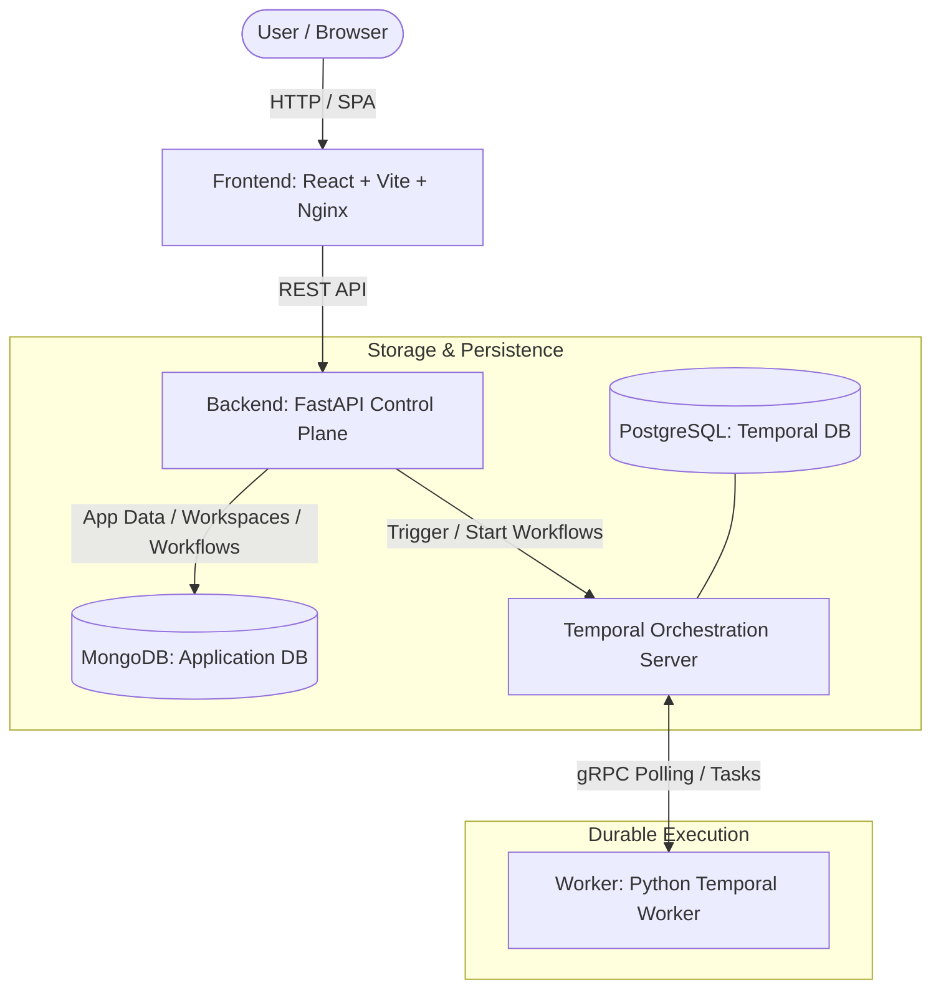

# NexusMCP Architecture Overview

NexusMCP is an AI-powered, self-hosted workflow automation platform built for high reliability, durable background execution, and strict modular boundaries.

---

## High-Level Architecture Diagram

---

## Architectural Boundaries

Per `rules.md`, NexusMCP strictly isolates responsibilities:

1. **API / Control Plane (`backend/app/main.py`, `backend/app/api/`)**:
   - Manages authentication, workspace isolation, configuration, health/readiness probes, and workflow CRUD operations.
   - Does NOT run long-running tasks or background orchestration directly.

2. **Durable Execution Layer (`backend/app/worker.py`)**:
   - Temporal worker process running outside the FastAPI request-response lifecycle.
   - Polls task queues from Temporal Server for durable workflow execution and retries.
   - Side effects and network I/O are isolated inside activities.

3. **Persistence Layer**:
   - **MongoDB**: Used exclusively for application data (users, workspaces, workflow definitions, metadata, execution summaries, and audit logs). Workspaces are scoped via `workspace_id`.
   - **PostgreSQL**: Exclusively owned and managed by Temporal Server for execution history, state machines, and timer queues. Application logic never touches Temporal's internal tables directly.

4. **Frontend (`frontend/`)**:
   - Monitoring, configuration, and review interface built with React, Vite, and TypeScript.
   - Does not run persistent workflows in the browser; all execution is server-side and backgrounded.

5. **Deployment (`deployment/`)**:
   - Standardized Docker and Docker Compose environment.
   - Non-root user execution in application containers (`Dockerfile.backend`, `Dockerfile.worker`).
   - Named persistent volumes for MongoDB (`mongo_data`) and PostgreSQL (`postgres_data`).
   - Health check probes on every critical service ensuring dependency-ready startup.

---

## 6. Durable Workflow Runtime and Execution Model (Phase 8)

NexusMCP implements a reliable Temporal-based execution engine (`backend/app/execution/`) designed for self-hosted environments:

### Orchestration Design
- **Model**: Single Execution Orchestration Model (`WorkflowExecution`). Each accepted trigger event or manual run launches an independent, isolated Temporal workflow instance identified deterministically as `wf-{workflow_id}-{execution_id}`.
- **Independence**: Background execution runs fully decoupled from the frontend browser and FastAPI API process lifecycles. Worker or API restarts do not drop in-flight state.
- **Workflow Determinism**: Temporal workflow functions contain zero external network calls, direct database queries, or non-deterministic operations. Time operations use `workflow.now()`.

### Temporal Activities (`backend/app/execution/activities.py`)
- **Tool Invocation**: External side effects (Composio actions, MCP server calls) and data transformations are executed exclusively inside Temporal activities (`execute_step`).
- **Condition & Argument Evaluation**: Pre-conditions and dynamic data mappings (`trigger.data.*`, `steps.<id>.output.*`) are resolved prior to tool invocation. Steps with unmet conditions are marked `skipped`.

### Serializable Activity Data & Payload Externalization
- **Compact Payloads**: Activity inputs and outputs remain small, serializable dictionaries to respect Temporal gRPC payload boundaries and history performance.
- **Threshold Storage**: Payloads exceeding 32 KB are stored in the MongoDB `execution_payloads` collection, passing a compact reference `{"$ref": payload_id, "size_bytes": ..., "preview": ...}` through Temporal.

### Reliability, Retries & Heartbeats
- **Failure Classification**: Distinguishes transient failures (HTTP 429 rate limits, network resets, 5xx outages) from permanent errors (schema validation failures, missing tools, 401/403 auth errors). Permanent failures raise non-retryable `ApplicationError`.
- **Configurable Policies**: Uses `step.error_policy` to define initial delay, backoff multiplier, and max retry attempts in Temporal's `RetryPolicy`. Supports `stop` and `continue` failure handling strategies.
- **Heartbeats & Cancellation**: Activities send heartbeats during long-running tasks and respect Temporal cancellation signals.

### Idempotency & Step Checkpointing
- **Deterministic Keys**: Side-effecting operations generate deterministic idempotency keys: `idem-{workspace_id}-{workflow_id}-v{version}-{execution_id}-{step_id}`.
- **Step Memoization**: Step outcomes are recorded in `step_executions`. If a worker crashes or an activity retries, completed steps return their cached result from MongoDB without re-executing external actions.

### Version Pinning & Trigger Identity
- **Version Snapshots**: Every execution is pinned to the exact immutable `workflow_version` active at trigger time. Subsequent edits or activations do not affect running executions.
- **Originating Event Identity**: The trigger event ID, provider, type, and payload data are preserved and made accessible to downstream steps.
